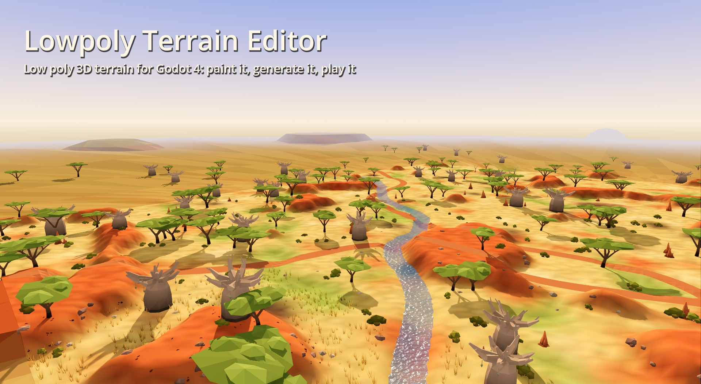
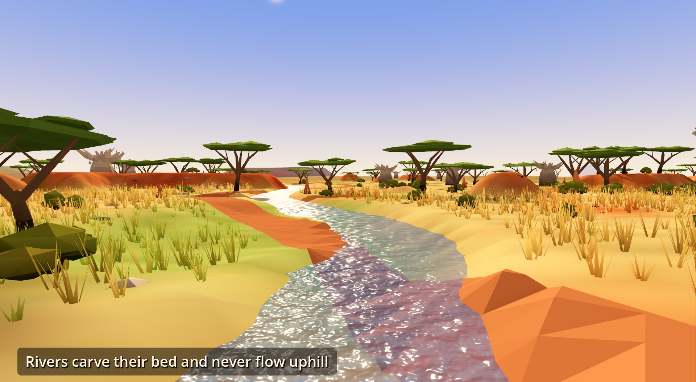
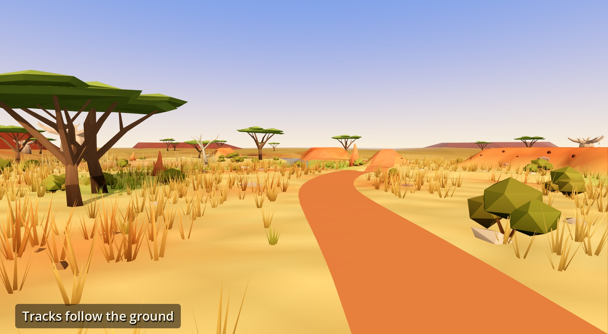
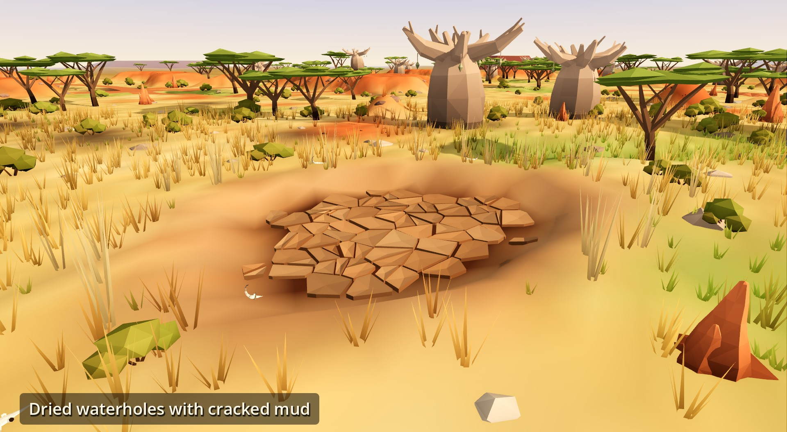
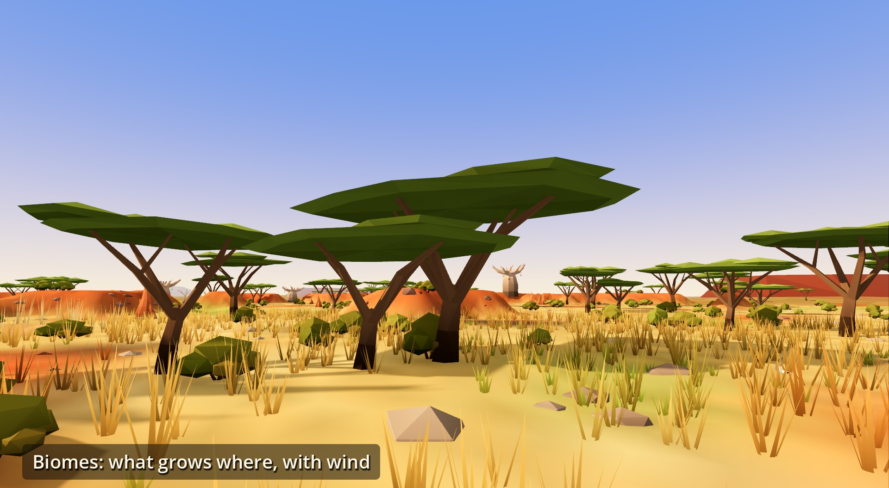
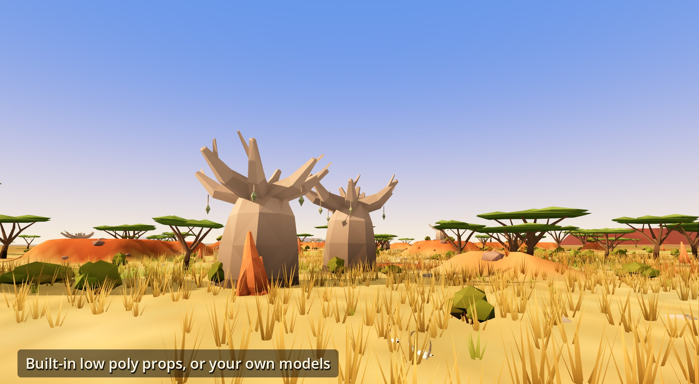
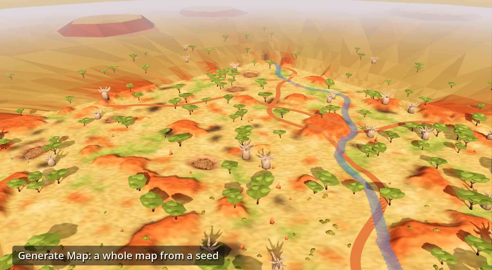
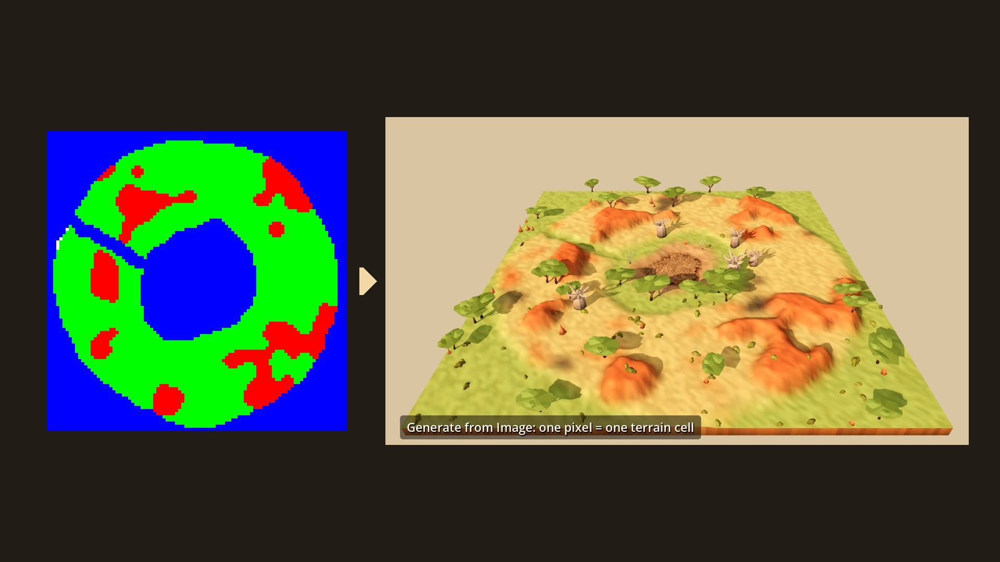
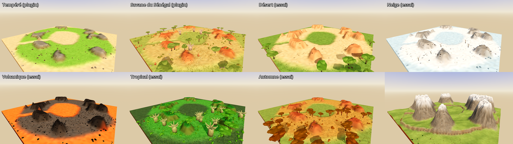
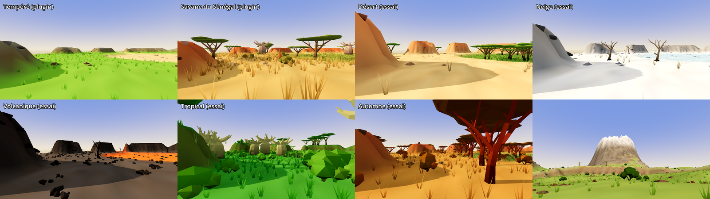

# Lowpoly Terrain Editor

Godot 4 editor plugin to paint low poly 3D terrain by hand, or generate it from a seed or
from a small pixel image (1x1 to 256x256). Ground styles, relief, roads, rivers, dried
waterholes, grass, trees and props, biomes, big streamed maps and phone-friendly settings.



<p>






</p>

*Every shot above is one map made by **Generate Map** (Senegal Savanna preset, seed 7, plus
one river), untouched. The light (low warm sun, haze) and the far landscape come from the test
project: the plugin builds the terrain, each game lights it its own way.*

## Features

| Area | What it does |
|---|---|
| Tools | 7 tools in the 3D editor menu bar: **Ground** (paint a ground style), **Relief** (raise / dig / smooth), **Flatten**, **Road**, **River**, **Waterhole**, **Vegetation** (more / fewer plants, or one tree or prop per click). Undo / Redo everywhere. |
| Biomes | A biome is a reusable `.tres`: ground styles, baked shading (blend, slope tint, ambient occlusion, cliff darkening), waterhole colours and detail layers (what grows, how dense, on which ground and slope). Presets: **Temperate**, **Senegal Savanna** (dry grass, laterite, acacias, baobabs, termite mounds). |
| Details | Grass, rocks, shrubs, trees and props drawn as one MultiMesh per layer and chunk, with wind on plants, collision for trees, and your own models (`.glb`, `.gltf`, `.blend`, `.fbx`, `.tscn`) as detail layers. |
| Map generation | **Generate Map** from a recipe + seed (same seed = same map): plateaus, lowlands, ground patches, tracks, waterholes. Presets: Senegal Savanna, Temperate Island. |
| Pixel maps | **Generate from Image**: white = empty, green = ground, red = raised, blue = lowered. `map-editor.html` (offline, in the browser) generates and edits these maps. |
| Look | Smooth or faceted ground, baked shading, up to 7 textured ground styles blended together, your own Ground / Detail materials (toon, unshaded...). |
| In game | A `_LowpolyTerrainRuntime` child rebuilds what the scene does not store, spread over frames, streams big maps around the player, can generate a new map at start (procedural levels), and emits `terrain_ready` to spawn the player. |
| Phones | Small scenes ("All at runtime" stores only the terrain data), water without screen-copy refraction, optional ground shadows, frame-budgeted building. |

### From a pixel map

Paint a small image with 4 colours (or make it in `map-editor.html`), drop it in
*Inspector > Advanced > Pixel Map* and click **Generate from Image**:



### Biomes

The same pixel map with each biome: the plugin's two (Temperate, Senegal Savanna), five
trial biomes made in the test project (desert, snow, volcanic, tropical, autumn) and a
mountain variant.





## Requirements

Godot **4.7** (developed and tested with 4.7.2). Works with the Forward+, Mobile and
Compatibility renderers.

## Installation

1. Copy `addons/lowpoly_terrain_editor` into your project's `addons/` folder.
2. In Godot: *Project > Project Settings > Plugins*, enable **Lowpoly Terrain Editor**.

## Quick start

1. Open a 3D scene and click **New Terrain** in the 3D editor menu bar.
2. Drag in the 3D view to add ground (Ground is already active), or click **Generate Map**
   in the Inspector (*Map* section).
3. Pick another tool in the menu bar. With a tool active:

   | Input | Action |
   |---|---|
   | Drag | Use the tool |
   | Ctrl + drag | Inverse tool (remove ground, dig, fewer plants) |
   | Shift + drag | Smooth |
   | `[` `]` | Brush size (road / river width) |
   | `-` `=` | Strength |
   | Esc | Leave the tool |
   | Alt + drag, right / middle mouse | Move the camera |

4. The Inspector has four sections in the order of a first map: **Map**, **Look**, **Roads,
   Rivers & Waterholes** and **Game**. Everything else is under **Advanced**. Hover a
   setting for its explanation.

The full guide is [`HOW TO USE.txt`](HOW%20TO%20USE.txt). Video: https://youtu.be/rg--qJoRvB0

## In game

The terrain gets a `_LowpolyTerrainRuntime` child (keep it: it also unpacks the terrain data
stored compressed in the scene).

```gdscript
@onready var runtime := $LowpolyTerrain/_LowpolyTerrainRuntime

func _ready() -> void:
    if runtime.is_ground_ready:
        _spawn_player()
    else:
        runtime.terrain_ready.connect(_spawn_player)  # ground + ground collision exist

func new_level() -> void:
    runtime.build(randi())  # with "Generate Map" ticked on the runtime node
```

- **Runtime Build** (*Inspector > Game*) chooses what the scene file stores: *All at runtime*
  (default, only the terrain data), *Details at runtime*, or *Save everything* (biggest
  scene, fastest loading).
- **Wind**: `MaterialFactory.set_wind(Vector2(dir_x, dir_z), strength)` (0 = calm, 1 =
  default, 2 = strong).
- **Lighting** (sky, fog, sun) and what lies past the map edge are up to your game: the
  test project has examples in `test_project/world/`.

## Repository

| Path | Content |
|---|---|
| `addons/lowpoly_terrain_editor/` | The plugin. `ARCHITECTURE.md` there describes its modules. |
| `map-editor.html` | Pixel map editor (React, one offline file). Source in `tools/pixel-map-editor/`. |
| `map-generator.html` | Older pixel map generator (random islands). |
| `tools/blender/` | Scripts that model the built-in props in Blender and convert them to GDScript. |
| `test_project/` | Godot project used to develop and test the plugin: scenes, benches, phone builds, look examples, check scripts and audit reports. |
| `docs/showcase/` | The images of this page, made by `test_project/tools/render_showcase.gd` (Forward+, 1920 x 1080). |

### Checks

From `test_project/`:

```
bash tools/run_checks.sh
```

It runs byte-exact fingerprints of the built meshes and details, 18 headless checks, the
static typing check (0 warnings) and an editor smoke test (180 checks). Godot path inside
the script.

## Version

0.0.1 by Galsen Games Studio. Audit of this version: `test_project/AUDIT_V0_0_1.md`.
