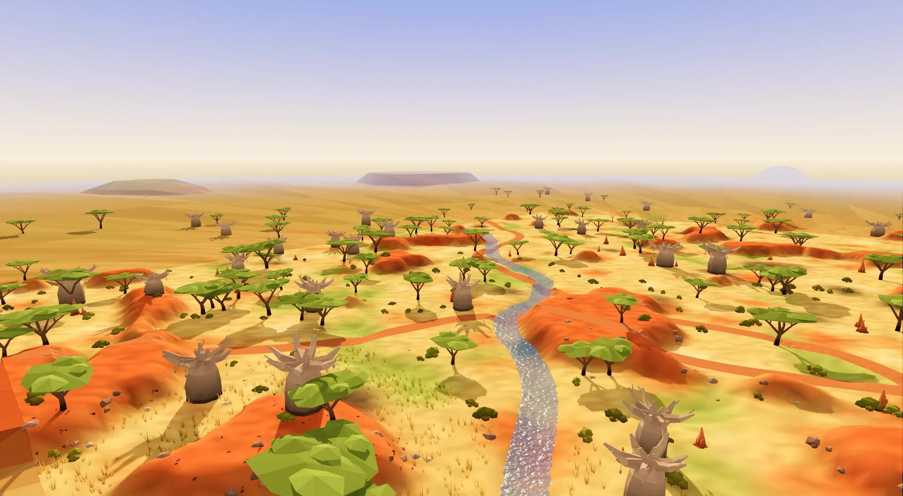

# Lowpoly Terrain Editor

Godot 4 editor plugin to paint low poly 3D terrain by hand, or generate it from a seed or a
small pixel image: ground styles, relief, roads, rivers, waterholes, plants, your own biomes,
streamed maps, phone-friendly.

**Documentation: https://jac0164.github.io/godot-3d-terrain-builder/**
([guide](https://jac0164.github.io/godot-3d-terrain-builder/guide.html),
[editor tour](https://jac0164.github.io/godot-3d-terrain-builder/editor.html),
[Pixel Map Editor](https://jac0164.github.io/godot-3d-terrain-builder/map-editor.html))

## Install

1. Copy `addons/lowpoly_terrain_editor` into your project's `addons/` folder.
2. *Project > Project Settings > Plugins*: enable **Lowpoly Terrain Editor**.
3. In a 3D scene, click **New Terrain** in the 3D editor menu bar, then drag in the view or
   click **Generate Map** in the Inspector.

Godot **4.7** (tested with 4.7.2), Forward+, Mobile and Compatibility renderers.

## Repository

| Path | Content |
|---|---|
| `addons/lowpoly_terrain_editor/` | The plugin (`ARCHITECTURE.md` there describes its modules). |
| `docs/` | The documentation site (GitHub Pages). |
| `test_project/` | The Godot project used to develop and test the plugin. `bash tools/run_checks.sh` runs every check. |
| `tools/` | Blender scripts for the built-in props, source of the Pixel Map Editor. |

## Credits

Version 0.0.1 by Galsen Games Studio, based on the original Lowpoly Terrain Editor (1.0) by
[OriginlessGamer](https://www.youtube.com/@OriginlessGamerApps).
